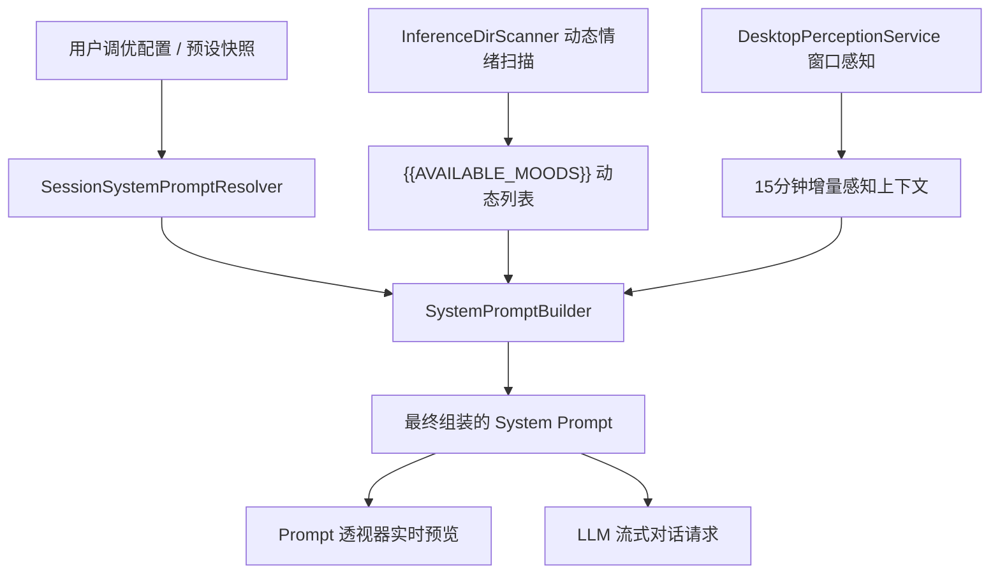
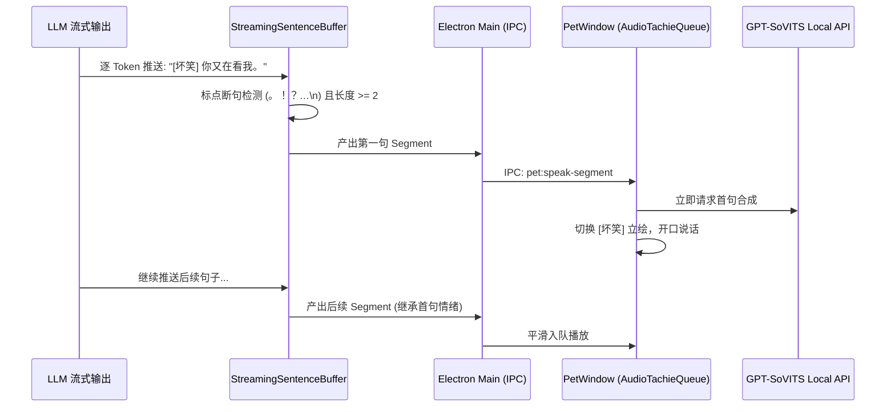
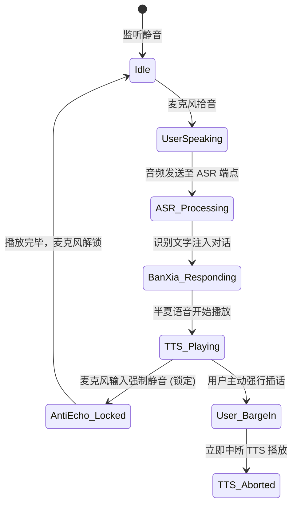

# 半夏 (BanXia) 开发者功能详解与架构设计文档

本文档面向参与或二次开发本项目的工程师与技术架构师，旨在系统性拆解项目的架构设计、模块拓扑、核心技术栈、关键机制实现原理与数据链路流转。

---

## 1. 系统定位与全局技术栈

### 1.1 系统定位
半夏（BanXia）是一个具备持久记忆、自主审美第一人称视角、原生桌宠交互、情绪化本地语音合成（GPT-SoVITS）、桌面窗口情境感知与提示词动态调优的**高拟真数字生命/创作者伴侣系统**。

### 1.2 核心技术栈
- **运行时宿主**：Electron 39.x + Node.js 22.x
- **前端框架**：React 19.x + TypeScript 5.x + Vite 6.x + CSS Modules
- **工程构建体系**：pnpm Workspace Monorepo + Turborepo 管道调度
- **存储架构**：
  - **物理 Markdown 文件（SSOT，真理单一来源）**：所有日常日记、随笔、小说档案均以人类可读的物理 `.md` 文件落盘。
  - **嵌入式关系引擎**：`better-sqlite3`（构建 `shadow_index` 镜像表、向量与全文本文 FTS 检索）。
- **AI 与 LLM 编排**：
  - OpenAI / Anthropic 兼容协议流式调用。
  - 自研轻量级工具系统（`@baishou/ai`）：`diary_write`、`diary_edit`、`diary_read`、`desktop_perception` 等。
- **语音推理 (TTS)**：直连本地部署的 `GPT-SoVITS-v2proplus` HTTP 推理服务（支持多音频动态池与随机权重）。
- **语音输入 (ASR)**：Electron 原生 `MediaRecorder` 音频采集 + OpenAI 兼容端点语音识别 + 防回声自激锁。

---

## 2. Monorepo 模块架构与工程拓扑

工程采用清晰的分层 Monorepo 结构，各包职能严格隔离：

```
H:\BanXia\
├── apps/
│   ├── desktop/                 # Electron 桌面端应用主工程
│   │   ├── src/main/            # Electron 主进程（生命周期、窗口管理、IPC、后台服务）
│   │   ├── src/preload/         # 安全隔离预加载层（contextBridge 暴露受限 API）
│   │   └── src/renderer/        # React 19 渲染进程（主界面、桌宠窗口、工作台、三抽屉）
│   └── mobile/                  # 移动端适配层（保持纯净独立）
├── packages/
│   ├── ai/                      # 大模型提示词装配、工作台合并、Agent 工具集
│   ├── core/                    # 纯逻辑领域服务（日记服务、GPT-SoVITS 客户端、向量服务）
│   ├── core-desktop/            # 依赖 Node.js/Electron 的核心服务（文件监听、物理文件同步）
│   ├── shared/                  # 跨进程通用工具（流式断句缓冲、语音标记解析、感知工具、语音输入控制器）
│   ├── database/                # SQLite Schema 定义、迁移引擎、表结构定义
│   ├── database-desktop/        # 桌面端 SQLite better-sqlite3 物理实例封装
│   ├── store/                   # 前端全局状态存储封装
│   └── ui/                      # 基础 UI 原子组件库
└── scripts/                     # 仓库构建与预置数据种子脚本
```

---

## 3. 核心功能实现原理解析

### 3.1 物理 Markdown SSOT 与三抽屉分流存储架构

系统彻底摒弃了传统笔记软件“按日强制合并（`mergeDiariesOnDateJump`）”的死板设计，实现了多业务目录分流与文件级单一真理来源（SSOT）：

```
{VaultRoot}/
├── Journals/                    # entryType: 'daily_diary', authorRole: 'user'
│   └── {YYYY}/{MM}/{YYYY-MM-DD}.md
├── Essays/                      # entryType: 'banxia_essay', authorRole: 'assistant'
│   └── {slug_or_id}.md
└── Novels/                      # entryType: 'novel_archive', authorRole: 'user'
    └── {slug_or_id}.md
```

#### 实现机制
1. **Frontmatter 元数据**：每个 Markdown 文件头部注入 YAML 元数据（`id`, `title`, `entryType`, `authorRole`, `createdAt`, `updatedAt`, `tags`）。
2. **双向镜像同步 (`file-sync.service.ts`)**：
   - 监听本地文件系统变更。当用户在外部编辑器（Obsidian、Typora、VS Code）修改物理文件时，Chokidar 文件监听器触发哈希比对。
   - 提取文件内容与 Frontmatter，增量更新 SQLite 中的 `shadow_index` 表，确保全文检索（FTS）与 RAG 向量索引实时同步。
3. **工具层写入路由 (`diary_write` / `diary_edit`)**：
   - 工具入参扩展了 `entryType`（默认 `'banxia_essay'`）与 `title`。
   - 半夏在聊天中写随笔时，底层直接分流写入 `Essays/` 独立文件，设置 `authorRole = 'assistant'`，完全杜绝脏写污染日常时间线。

---

### 3.2 提示词调优工作台与组装透视器 (Prompt Tuning Workbench)

为解决面对不同模型（DeepSeek、Claude、GPT-4o、本地小模型）时的脾气差异，实现了零重启的运行时提示词热覆盖系统。

#### 核心模块划分
- **模块 A (`<assistant_persona>`)**：半夏的核心人设与审美偏好。
- **模块 B (`<user_identity>`)**：魂小小的创作者身份画像与称谓习惯。
- **模块 C (`<companion_guidelines>`)**：陪伴准则、随笔创作倾向与工具调用习惯。
- **模块 D (`<expression_protocol>`)**：立绘与语音情绪标注输出规范。

#### 组装与渲染流程


- **模板变量替换**：`{{AVAILABLE_MOODS}}` 占位符在构建时被自动替换为本地 GPT-SoVITS 实际扫描到的有效情绪列表。
- **透视预览 (`getAssembledPrompt`)**：前端随时可调用 IPC 查看最终拼接的原生字符串，所见即所得。

---

### 3.3 GPT-SoVITS 本地推理引擎与动态情绪池架构

不同于传统单音频绑定的语音配置，本项目实现了多样本动态情绪池，赋予语音自然的语调起伏。

#### 1. 智能目录扫描 (`inference-dir-scanner.ts`)
支持三种灵活的本地推理目录组织方式，并自动排除 `audios/`、`voices/` 等通用目录名干扰：
- **JSON 映射表 (`voice_mood_map.json`)**：支持单文件或多文件数组映射。
- **情绪子目录分类**：如 `开心/01.wav`、`开心/02.wav`。
- **文件名情绪方括号标注**：如 `【坏笑】sample_01.wav`。

#### 2. 多参考音频池与随机抽取 (`randomPick`)
扫描结果生成 `moodPools: Record<string, RefAudioItem[]>`。在 `GptSovitsService.synthesize()` 发起合成请求时，从指定情绪池中随机抽取一条参考音频及其对应台词，保证多次表达同一情绪时的韵律丰富度。

#### 3. 情绪-立绘解耦回退机制 (`resolveFallbackTachie`)
用户或大模型可以扩展任意细分情绪（如 `[嘲讽]`、`[发呆]`、`[傲娇]`）。系统通过模糊匹配与语义降级规则，安全回退至桌宠支持的 6 大基准立绘：
$$\text{customMood} \xrightarrow{\text{resolveFallbackTachie}} \{\text{正常, 开心, 害羞, 生气, 难过, 坏笑}\}$$

#### 4. Markdown 链接防护正则
针对大模型输出中可能包含的 Markdown 链接（如 `[小说原文](file:///...)`），剥离语音情绪标签的正则表达式采用**负向预查断言**：
```typescript
const SPEECH_TAG_REGEX = /\[[\u4e00-\u9fa5a-zA-Z0-9_\-]+\](?!\()/g;
```
彻底杜绝因清理情绪标记而误损 Markdown 链接结构的隐患。

---

### 3.4 流式句级缓冲器 (`StreamingSentenceBuffer`) 与即时响应管线

针对大模型长段落生成延迟（6~8秒等待），设计了事件驱动的句级别分片管线：



- **跨句情绪继承**：后续句子若未重复打情绪标签，自动继承上一句的情绪与立绘设定，避免第二句话突然被打回“正常”中性立绘。
- **安全冲刷**：流结束时调用 `flush()` 冲刷尾句；对话出错或被主动打断时调用 `abort()` 清空播放队列。

---

### 3.5 Electron 原生透明置顶桌宠 (`PetWindow`)

#### 1. 窗口属性配置
```typescript
const petWindow = new BrowserWindow({
  transparent: true,
  frame: false,
  alwaysOnTop: true,
  hasShadow: false,
  skipTaskbar: true,
  resizable: false,
  webPreferences: { preload: ... }
});
```

#### 2. Canvas 像素级 Alpha 穿透算法
为了实现“在立绘上可以点击拖拽、在透明空白区域可以无阻碍点击底层编辑器/浏览器”，渲染层部署了离屏 Canvas：
```typescript
// 监听鼠标移动，检测指针所在坐标像素的 Alpha 值
const alpha = offscreenCtx.getImageData(x, y, 1, 1).data[3];
if (alpha <= 50) {
  // 命中透明区域：通知主进程开启鼠标穿透
  window.api.pet.setIgnoreMouseEvents(true, { forward: true });
} else {
  // 命中立绘实体：关闭穿透，响应鼠标交互与拖动
  window.api.pet.setIgnoreMouseEvents(false);
}
```

---

### 3.6 桌面窗口活动感知 (去预设化架构)

#### 1. 摒弃刻舟求剑的正则分类
早期实现采用硬编码正则匹配 `writing/art/gaming` 以及写死游戏白名单，带来了严重识别盲区。重构后遵循**只提取客观事实，由 LLM 理解意图**原则：
- 直接通过系统底层 API 提取当前前台激活的进程名与窗口标题：`[进程名] 窗口标题`。

#### 2. 隐私过滤与增量防噪音
- **敏感窗口脱敏**：命中密码库、无痕浏览、网银、Token等关键字时，内容替换为 `[敏感内容已脱敏]`。
- **15 分钟 TTL 增量机制**：记录 `lastInjectedTitle`、`lastInjectedProcess` 和 `lastInjectedTime`。当用户窗口未发生改变且未满 15 分钟时，返回 `undefined` 跳过注入，大幅节约 Prompt Token 并避免无意义复读。

---

### 3.7 双向语音交互与防自激回声锁

#### 1. 录音通道重构
`VoiceInputController` 抛弃了不稳定的外部注入机制，改用 Chromium/Electron 原生 `MediaRecorder` API 捕获音频流并封包为 Blob。

#### 2. 状态机与防回声锁 (Anti-Echo Lock)


---

## 4. 数据库设计与 Schema 规范

系统基于 SQLite 构建了 `shadow_index` 表，充当物理 Markdown 文件的关系索引与全文检索（FTS）引擎：

```sql
CREATE TABLE IF NOT EXISTS shadow_index (
  id TEXT PRIMARY KEY,
  file_path TEXT NOT NULL UNIQUE,
  entry_type TEXT NOT NULL CHECK(entry_type IN ('daily_diary', 'banxia_essay', 'novel_archive')),
  author_role TEXT NOT NULL CHECK(author_role IN ('assistant', 'user')),
  title TEXT,
  slug TEXT,
  tags TEXT, -- JSON 数组存储
  created_at TEXT NOT NULL,
  updated_at TEXT NOT NULL,
  content_hash TEXT NOT NULL,
  raw_content TEXT NOT NULL
);

CREATE INDEX IF NOT EXISTS idx_shadow_type_role ON shadow_index(entry_type, author_role);
CREATE INDEX IF NOT EXISTS idx_shadow_updated ON shadow_index(updated_at DESC);
```

---

## 5. 质量保证与自动化测试

项目建立了严格的单元测试与集成测试保障体系：
- **测试框架**：Vitest
- **半夏专项套件**：
  - `banxia-phase1.test.ts`：数据模型、Schema 扩展与三抽屉文件隔离
  - `banxia-seed.test.ts`：预置随笔与小说档案原文完整性断言
  - `banxia-phase3.test.ts`：GPT-SoVITS 服务、目录扫描与桌宠交互
  - `banxia-phase4.test.ts`：端到端闭环链路、语音队列与防回声锁
  - `banxia-phase5.test.ts`：流式缓冲、动态情绪池、提示词工作台与随笔工具升级
- **覆盖率与通过率**：全量 186 个测试文件、1253 个核心单测通过率 **100%**；Monorepo 11 个包 TypeScript 静态检查 **0 错误**。
